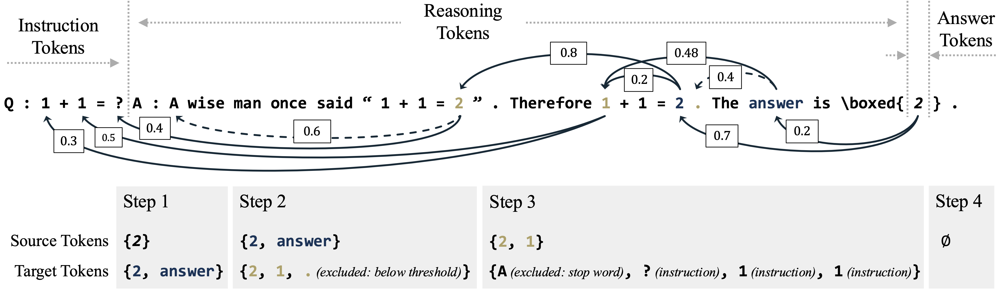

# UQAC：基于 Attention Chain 的大模型不确定性量化

本仓库是论文 **UQAC: LLM Uncertainty Quantification with Attention Chain**
的 RTX 4090 完整复现版本。代码基于上游提交
[`610e9a4`](https://github.com/Yinghao-Li/UQAC/commit/610e9a436e043e0643da08f9ff84201d5a68a2e1)，
并加入单张 24 GB 显卡适配、断点恢复脚本以及完整指标结果。

- [论文](https://openreview.net/pdf?id=QTrW2HWNXe)
- [原始代码仓库](https://github.com/Yinghao-Li/UQAC)
- [完整复现说明](reproduction/README.md)



## 复现状态

| 项目 | 状态 |
|---|---|
| 数据集 | GSM8K、MATH、BBH |
| 模型 | 论文中的 9 个模型 |
| 实验组合 | 27 / 27 已完成 |
| 推理精度 | BF16，无量化 |
| Self-Consistency | 温度 0.5，随机种子 0–4 |
| 硬件 | 单张 NVIDIA RTX 4090 24 GB |
| 结果文件 | 81 个指标 CSV、27 个论文格式 LaTeX 表 |

## 论文环境与复现配置对比

论文设置取自正文第 5 节及附录 C.1-C.3；复现设置以本仓库最终运行脚本和
`requirements-4090.txt` 为准。`未披露` 表示论文没有提供足够信息，不能将其
误判为一致。已知差异及其可能影响如下。

| 配置项 | 论文原文 | 本次复现 | 结论 | 说明 |
|---|---|---|---|---|
| GPU | 1 × NVIDIA A100-SXM4 80 GB | 1 × NVIDIA RTX 4090 24 GB | **不同** | 主要影响显存容量、运行时间与底层算子；这是 4090 适配的根本原因。 |
| 数值精度 | BF16 | BF16，明确关闭 4-bit 量化 | **精度一致** | 论文未单独说明是否量化；复现未使用量化，避免额外精度损失。 |
| 模型与数据集 | 9 个模型；GSM8K、MATH、BBH 测试集 | 相同 9 个模型与测试集 | **一致** | 27 个数据集/模型组合全部完成。 |
| Prompt | GSM8K/MATH zero-shot；Gemma 强制 `\boxed{}`；BBH 3-shot 并强制 `\boxed{}` | 沿用上游数据处理及 Prompt | **一致** | 未针对复现结果重新调 Prompt。 |
| 常规答案生成 | temperature = 0，top-p = 1 | temperature = 0；vLLM 默认 top-p = 1 | **一致** | 确定性生成。 |
| Self-Consistency | 5 个独立样本，temperature = 0.5；seeds 0-4 | 5 个样本，temperature = 0.5；seeds 0-4 | **一致** | 上游公开脚本写的是 0.3；最终复现已按论文改为 0.5，早期 0.3 结果未计入本表。 |
| UQAC 超参数 | $C=10$，$K=16$，$L_{tgt}=3$，$\theta=0.5$，达到 5 个 chain token 后应用阈值，$L'_{attn}=10$ | 相同设置 | **一致** | 使用统一超参数，没有针对 4090 重新调参。 |
| 论文所称最大序列长度 | GSM8K/MATH 1,024；BBH 1,536；DeepSeek-R1 额外 +512 | 生成阶段 model context 通常为 2,048；MATH/BBH 的 UQ 阶段分别使用 1,024/1,536；DeepSeek 的 MATH/BBH 再 +512 | **部分一致** | 复现将 model context 与生成上限拆开，以容纳 VU 追加 Prompt；因此 context/filter 行为并非完全相同。 |
| GSM8K 的 DeepSeek 生成上限 | 按论文描述应在 1,024 基础上额外 +512 | `max_new_tokens=1024`，未单独 +512；model context 为 2,048 | **不同** | 可能截断更长的 deep-thinking 回答，是 GSM8K DeepSeek 与论文结果差异的潜在来源。 |
| MATH/BBH 的 DeepSeek 生成上限 | 分别为 1,536 / 2,048 | 分别为 1,536 / 2,048 | **一致** | 按论文要求增加 512 tokens。 |
| 评估抽样 | 正误样本平衡；每类最多 500；重复 5 次，seeds 0-4 | 相同 | **一致** | README 指标中的标准差来自这 5 次抽样。 |
| ECE | 20 个等宽 bins | 20 个等宽 bins | **一致** | AUROC 与 ECE 计算口径不变。 |
| 显存管理 | 80 GB A100；未描述 CPU offload | 大模型 UQ 设置 12 GiB GPU 上限；DeepSeek 的 MATH/BBH 设置 8 GiB，并将 attention 输出移至 CPU | **不同** | 用于避免 24 GB 显存溢出；保持 BF16 数值，但设备迁移和算子实现可能带来极小数值差异。 |
| Attention 处理与恢复 | 未描述分块或断点恢复 | CPU stacking、分块 entropy、逐实例 HDF5 保存与断点恢复 | **实现不同** | 不修改指标定义，主要改变峰值显存、I/O 和运行可靠性。 |
| 软件版本 | 论文未披露 | Python 3.12 兼容层；PyTorch 2.4.0、Transformers 4.46.0、vLLM 0.6.3.post1 等 | **无法比较** | 完整版本固定在 `requirements-4090.txt`；软件栈差异可能影响生成结果。 |

因此，本次属于**相同模型、数据、核心算法超参数与评估口径下的硬件受限复现**，
不是论文 A100 环境的逐位等价重放。解释下方指标差异时，应优先考虑 GPU/软件栈、
序列长度处理及 4090 显存适配带来的影响。

## 论文 Table 1 与复现结果对比

下表中的论文值来自原文 Table 1，复现值由仓库内 9 个模型的指标按论文脚本
取平均得到。数值单位为百分比，均按 `均值 ± 标准差` 展示；`Δ` 为“复现均值
- 论文均值”（百分点）。AUROC 越高越好，ECE 越低越好，因此 AUROC 的正
差值和 ECE 的负差值表示改善。预测熵的 ECE 在论文中不适用，以 `-` 表示。

<details open>
<summary><strong>GSM8K</strong></summary>

| 方法 | 论文 AUROC | 复现 AUROC | Δ | 论文 ECE | 复现 ECE | Δ |
|---|---:|---:|---:|---:|---:|---:|
| $\bar P_M(x_{ans})$ | 60.9 ± 0.6 | 56.5 ± 0.5 | -4.4 | 49.4 ± 0.0 | 48.9 ± 0.1 | -0.5 |
| $\bar P_M(x_{resp})$ | 61.1 ± 0.8 | 61.9 ± 0.8 | +0.8 | 41.9 ± 0.0 | 40.9 ± 0.0 | -1.0 |
| $P_M(x_{ans}\mid x_{cot},x_{instr})$ | 60.7 ± 0.6 | 56.5 ± 0.4 | -4.2 | 48.4 ± 0.1 | 48.2 ± 0.2 | -0.2 |
| $P_M(x_{resp}\mid x_{instr})$ | 66.7 ± 0.7 | 67.0 ± 0.7 | +0.3 | 50.0 ± 0.0 | 50.0 ± 0.0 | 0.0 |
| $1-\bar H$ | 61.8 ± 0.8 | 62.7 ± 0.8 | +0.9 | 33.2 ± 0.1 | 29.4 ± 0.1 | -3.8 |
| $1-H$ | 67.1 ± 0.8 | 67.6 ± 0.7 | +0.5 | - | - | - |
| Self-Consistency | 66.4 ± 1.9 | 68.6 ± 0.9 | +2.2 | 28.9 ± 0.8 | 25.0 ± 0.5 | -3.9 |
| Verbalized | 54.9 ± 0.5 | 55.2 ± 0.5 | +0.3 | 42.9 ± 0.2 | 43.0 ± 0.2 | +0.1 |
| UQAC-$\tilde P_{M,attn}$ | 58.4 ± 0.8 | 60.3 ± 0.8 | +1.9 | 37.4 ± 0.6 | 37.5 ± 0.5 | +0.1 |
| UQAC-$\tilde P_{M,sim}$ | 60.7 ± 1.0 | 61.2 ± 0.7 | +0.5 | 28.0 ± 0.5 | 27.1 ± 0.7 | -0.9 |
| UQAC-$\tilde P_M$ | 61.3 ± 0.9 | 61.2 ± 0.7 | -0.1 | 33.6 ± 0.4 | 32.2 ± 0.3 | -1.4 |

</details>

<details>
<summary><strong>MATH</strong></summary>

| 方法 | 论文 AUROC | 复现 AUROC | Δ | 论文 ECE | 复现 ECE | Δ |
|---|---:|---:|---:|---:|---:|---:|
| $\bar P_M(x_{ans})$ | 74.2 ± 1.2 | 64.5 ± 1.0 | -9.7 | 48.1 ± 0.2 | 47.9 ± 0.2 | -0.2 |
| $\bar P_M(x_{resp})$ | 69.0 ± 1.5 | 64.2 ± 1.3 | -4.8 | 41.5 ± 0.1 | 41.1 ± 0.1 | -0.4 |
| $P_M(x_{ans}\mid x_{cot},x_{instr})$ | 73.9 ± 1.2 | 64.4 ± 1.0 | -9.5 | 43.7 ± 0.3 | 43.3 ± 0.3 | -0.4 |
| $P_M(x_{resp}\mid x_{instr})$ | 79.0 ± 1.1 | 72.3 ± 1.5 | -6.7 | 50.0 ± 0.0 | 50.0 ± 0.0 | 0.0 |
| $1-\bar H$ | 69.3 ± 1.5 | 64.7 ± 1.3 | -4.6 | 35.3 ± 0.2 | 29.6 ± 0.2 | -5.7 |
| $1-H$ | 78.6 ± 1.1 | 72.6 ± 1.4 | -6.0 | - | - | - |
| Self-Consistency | 79.5 ± 1.0 | 79.2 ± 1.1 | -0.3 | 15.8 ± 0.8 | 15.5 ± 0.8 | -0.3 |
| Verbalized | 57.4 ± 0.7 | 56.9 ± 1.2 | -0.5 | 45.1 ± 0.2 | 43.7 ± 0.7 | -1.4 |
| UQAC-$\tilde P_{M,attn}$ | 68.6 ± 1.2 | 63.6 ± 1.4 | -5.0 | 42.8 ± 0.5 | 42.2 ± 0.4 | -0.6 |
| UQAC-$\tilde P_{M,sim}$ | 68.0 ± 1.3 | 63.8 ± 1.3 | -4.2 | 21.6 ± 1.0 | 22.9 ± 0.9 | +1.3 |
| UQAC-$\tilde P_M$ | 69.5 ± 1.2 | 66.9 ± 1.1 | -2.6 | 25.8 ± 0.9 | 27.7 ± 0.6 | +1.9 |

</details>

<details>
<summary><strong>BBH</strong></summary>

| 方法 | 论文 AUROC | 复现 AUROC | Δ | 论文 ECE | 复现 ECE | Δ |
|---|---:|---:|---:|---:|---:|---:|
| $\bar P_M(x_{ans})$ | 65.0 ± 0.9 | 64.3 ± 0.9 | -0.7 | 44.6 ± 0.3 | 44.5 ± 0.3 | -0.1 |
| $\bar P_M(x_{resp})$ | 59.3 ± 1.3 | 57.2 ± 1.3 | -2.1 | 42.6 ± 0.2 | 40.8 ± 0.1 | -1.8 |
| $P_M(x_{ans}\mid x_{cot},x_{instr})$ | 66.1 ± 0.8 | 65.2 ± 0.9 | -0.9 | 38.1 ± 0.5 | 37.4 ± 0.6 | -0.7 |
| $P_M(x_{resp}\mid x_{instr})$ | 63.6 ± 1.5 | 61.7 ± 1.1 | -1.9 | 45.3 ± 0.4 | 46.8 ± 0.2 | +1.5 |
| $1-\bar H$ | 59.4 ± 1.3 | 57.0 ± 1.3 | -2.4 | 33.5 ± 0.4 | 30.7 ± 0.5 | -2.8 |
| $1-H$ | 63.6 ± 1.2 | 60.8 ± 1.2 | -2.8 | - | - | - |
| Self-Consistency | 79.5 ± 1.0 | 84.4 ± 0.6 | +4.9 | 31.6 ± 0.7 | 20.5 ± 0.5 | -11.1 |
| Verbalized | 58.2 ± 1.2 | 60.9 ± 1.6 | +2.7 | 39.7 ± 0.3 | 37.2 ± 0.6 | -2.5 |
| UQAC-$\tilde P_{M,attn}$ | 64.6 ± 1.3 | 63.0 ± 1.1 | -1.6 | 23.4 ± 1.0 | 26.3 ± 0.9 | +2.9 |
| UQAC-$\tilde P_{M,sim}$ | 65.1 ± 1.2 | 62.6 ± 1.3 | -2.5 | 22.1 ± 1.0 | 23.5 ± 1.0 | +1.4 |
| UQAC-$\tilde P_M$ | 66.7 ± 1.2 | 63.7 ± 1.1 | -3.0 | 24.2 ± 0.9 | 24.0 ± 0.9 | -0.2 |

</details>

- 完整指标：[`results/`](results/)
- 论文格式表格：[`reproduction/tables10-36/`](reproduction/tables10-36/)
- 论文与复现实验口径对照：[`results/table1-paper-vs-reproduction.md`](results/table1-paper-vs-reproduction.md)
- 4090 兼容修改与运行细节：[`reproduction/README.md`](reproduction/README.md)

仓库仅保留代码和聚合指标。模型权重、原始生成文本、数据集及 HDF5
注意力中间结果体积较大，未提交到 Git。

## 在 RTX 4090 上运行

```bash
git clone https://github.com/O-utIn/UQAC.git
cd UQAC
pip install -r requirements-4090.txt

# 以下示例复现一个模型在三个数据集上的结果。
bash reproduction/run_gsm8k_model.sh Qwen2.5-1.5B-Instruct 1
bash reproduction/run_dataset_model.sh math Qwen2.5-1.5B-Instruct 1
bash reproduction/run_dataset_model.sh bbh Qwen2.5-1.5B-Instruct 1
```

复现脚本保留了实验服务器上的绝对路径 `/root/autodl-tmp/UQAC` 和
`/root/autodl-tmp/models`；在其他位置运行前，请统一替换这些路径。
脚本支持断点续跑，已完成的产物会被跳过。完整实验矩阵、批量运行器及
兼容性修改见 [`reproduction/README.md`](reproduction/README.md)。

## 目录说明

```text
reproduction/              # 4090 运行、恢复和汇总脚本
reproduction/tables10-36/  # 27 个论文格式 LaTeX 表
results/output/             # UQAC 与 token baseline 指标
results/output-sc/          # temperature=0.5 的 Self-Consistency 指标
src/                        # UQAC 核心实现（含 4090 适配）
scripts/                    # 上游原始运行脚本
```

## 上游项目使用说明

以下内容保留自原始仓库，用于说明标准 UQAC 流程。

## Environment Setup

The upstream project targets Python 3.10. Dependencies are specified in
`requirements.txt`; for this RTX 4090 reproduction, prefer
`requirements-4090.txt`.

```bash
pip install -r requirements.txt
```

It's recommended to use a new virtual environment. The versions in `requirements.txt` serve as a reference, and newer package versions are generally supported. If additional packages are required, please install them according to error messages during runtime.

## Data Preparation

Evaluation datasets include GSM8k, MATH, and BBH. Preparation scripts are provided under `./run/data`. To construct these datasets, run:

```bash
export PYTHONPATH="."
python ./run/data/gsm8k_.py
python ./run/data/math_.py
python ./run/data/bbh_.py
```

Datasets will be downloaded and prepared automatically in `./datasets/`. Optionally, you may remove intermediate folders (`./datasets/train/` and `./datasets/tmp/`).

To use custom datasets, organize your data similarly by following the provided scripts. You may also need to define custom answer extraction functions (see examples in `./src/eval/__init__.py`).

## Model Preparation

For experiments, we clone LLM models from [Huggingface Models](https://huggingface.co/models) into the directory `../models/`, relative to the root of this project.

To use alternative directories or cached models, modify the paths in shell scripts located in `./scripts/`.

## Running UQAC

UQAC operates in three sequential stages: 

1. Answer inference
2. Attention chain construction
3. Ensembling

While these steps incur additional computation compared to the described article method, they provide enhanced flexibility and interpretability.

### 1. Answer Inference

Responses from LLMs are obtained using `vllm`:

```bash
sh ./scripts/infer-vllm.sh
```

Results (`results.json`) will be stored in `./output/<dataset>/<model>/`.

### 2. Attention Chain Construction

This step constructs attention chains by backtracking through influential tokens, storing relevant attributes:

```bash
sh ./scripts/infer-uq.sh
```

Attributes are stored in `./output/<dataset>/<model>/attrs/<instance_index>/attrs.h5`.

### 3. Ensembling

Ensembling marginalizes the reasoning space to compute final answer probabilities. The process is parallelized at the instance level:

```bash
sh ./scripts/infer-ens.sh
```

Ensemble results are saved in `./output/<dataset>/<model>/results-ens/10-0.0.json`, containing joint probabilities of answers and reasoning chains.

## Evaluation

To generate evaluation metrics, run:

```bash
sh ./scripts/eval/eval.sh
```

Metrics will appear in a table (`metrics.csv`) located at `./output/<dataset>/<model>/`. For correspondence between metrics rows and baseline labels, refer to `./assist/metric2latex.py`, lines 135–152.

## Baselines

Scripts for baselines described in our paper are provided in `./scripts/baseline/`, with their evaluation scripts located at `./scripts/eval/`.

## Assistant Scripts

Additional scripts to generate tables and plots from the paper are available in the `./assist/` directory.
